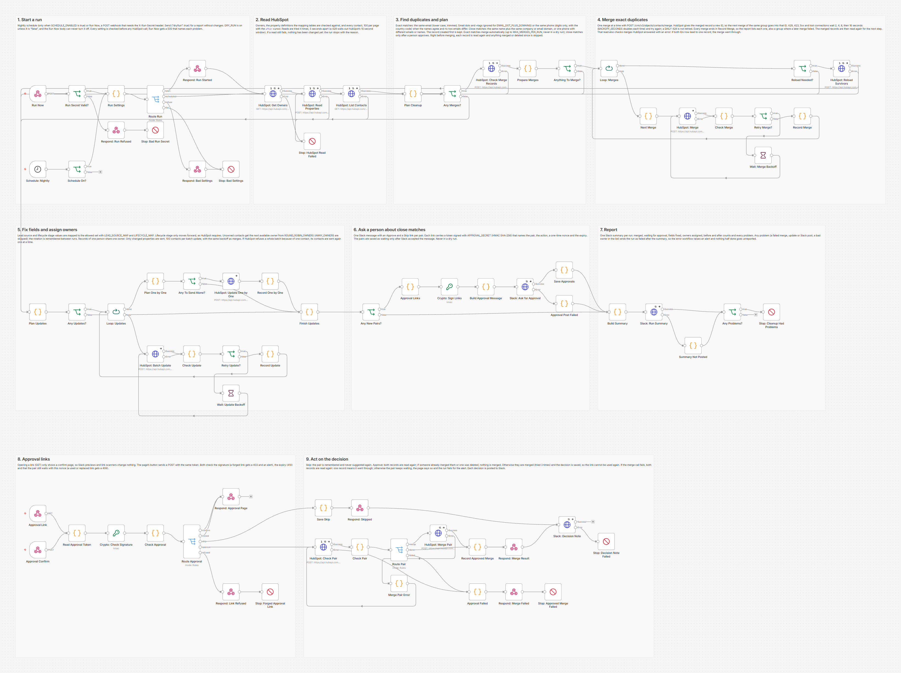
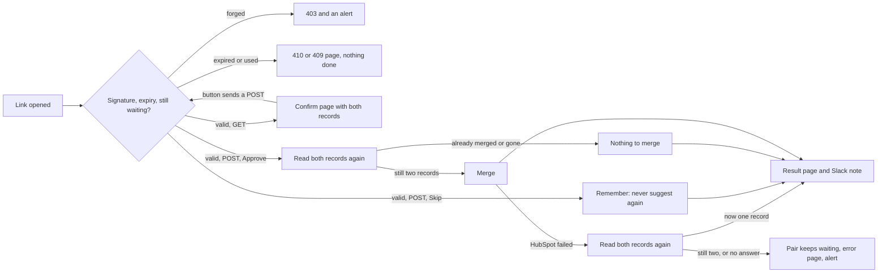

# HubSpot Duplicate Cleanup and Lead Routing: n8n

Finds duplicate contacts in HubSpot every night, merges the exact ones with safeguards, asks a person in Slack about the close ones, maps messy lifecycle stage and lead source values to your allowed set, and gives every unowned contact an owner by round robin. Built with n8n.



## The problem

A sales team's HubSpot fills up with the same people. Someone fills in a web form, a rep adds them by hand from a phone call, a list import adds them again with a different email. Lead sources arrive as "google ads", "AdWords" and " PPC ", stages from an old CRM sit in a text field, and new leads land with no owner, so nobody calls them. Cleaning this by hand is slow and risky: HubSpot cannot undo a merge, a wrong one joins two real customers, and routing new leads fairly by hand never stays fair for long.

## What this does

1. **Reads every contact** through the HubSpot CRM v3 API, page by page, every night or when you press Run Now.
2. **Finds exact duplicates**: the same email (lower case, trimmed; Gmail dots and `+tags` are ignored for the domains you list) or the same phone (digits only, with the country code; placeholders such as 000-000-0000 never match). A shared phone only counts as exact when the records do not hold two different emails and the names agree (the same last name, and first names that match or where one starts the other, like "Marc" and "Marcus"), because an office line is not a person.
3. **Finds close matches**: the same name (accents and case ignored) plus the same company ("Inc.", "LLC" and "&" ignored) or the same work email domain (Gmail, Outlook and other free mail domains never count), or one phone where the emails or the names differ.
4. **Keeps the record created first.** It carries the original source and the longest history; ties go to the lower record ID.
5. **Merges exact duplicates by itself, carefully.** Nothing is merged while `DRY_RUN` is on (the default). When it is off, at most `MAX_MERGES_PER_RUN` merges run per night, all records due to merge are read again right before merging, and anything someone merged or deleted in HubSpot since the first read is skipped and reported. After the merges the records are read again, which also settles a merge HubSpot answered with an error: if both IDs now lead to one record, it went through.
6. **Asks a person about close matches.** One Slack message lists them, each with an Approve and a Skip link. The links carry a token signed with HMAC SHA-256, expire after `APPROVAL_LINK_HOURS` and work once. Opening a link only shows a confirm page; nothing changes until the button on that page is pressed. Skipped pairs are never suggested again.
7. **Cleans two fields with mapping tables.** Lead source values are mapped to your allowed list in place. Stage values from an old import are mapped to HubSpot's real lifecycle stage, and the stage only ever moves forward, as HubSpot requires. Only properties whose value actually changes are sent. If HubSpot refuses a whole batch update because of one contact, the contacts of that batch are sent again one at a time, so one bad value does not hold back the rest.
8. **Routes unowned contacts by round robin** over the owners you list, checked against HubSpot's owners API. Owners marked away are skipped, the rotation is remembered between runs, and records that are one person share one owner, so two reps never chase the same lead.
9. **Reports once per run** in Slack: merged, waiting for approval, fields fixed, owners assigned, before and after counts and every problem. Any problem ends the run as failed after the report, so the error workflow raises an alert.

## How it works

The nightly part:

```mermaid
flowchart LR
    A[Nightly schedule or Run Now] --> B{Secret and settings OK?}
    B -->|no| X[401 or 500, and an alert]
    B -->|yes| C[Read owners, property definitions, all contacts]
    C --> D[Find exact and close matches, plan merges up to the cap]
    D -->|dry run, or nothing to merge| U
    D -->|merges planned| E[Read those records again]
    E --> F[Merge one at a time, back off on 429 and 5xx]
    F --> G[Read the merged records, and both records of any merge HubSpot refused]
    G --> U[Plan field fixes and owners]
    U -->|live, changes to send| V[Batch update: only changed properties]
    U -->|live, nothing to change| W
    V -->|batch refused as a whole| O[Send its contacts one at a time]
    O --> W
    V --> W{New close matches?}
    U -->|dry run| S
    W -->|yes| Y[Slack: Approve and Skip links, then remember the pairs]
    W -->|no| S
    Y --> S[Slack summary]
    S -->|any problem| Z[Run fails, error alert]
```



The approval part, when someone opens a link from Slack:



**Why nothing is merged by mistake.** `DRY_RUN` is on unless it is `false`, and the Run Now body can ask for a dry run but never turn it off. Close matches are never merged without a person, and a phone number alone never merges two records whose names do not agree, or a record that has no name. The merges are preceded by a fresh read of every record involved: HubSpot gives a merged record a new ID and keeps the old IDs in `hs_merged_object_ids`, so a record merged by someone else in the meantime is recognized and skipped instead of merged a second time. If HubSpot answers an old ID with nothing at all (its docs do not say which it does), the record counts as gone and is skipped too. The second merge of a group of three goes into the new ID the first merge returned.

**Why a link cannot be faked or used twice.** The Approve and Skip links carry the pair, the action, a one-time nonce and the expiry, signed with `APPROVAL_SECRET`. The workflow checks the signature in constant time, then the expiry, then that the pair still waits for a decision with that exact nonce. Each decision is stored with the pair, so a later click finds it already decided. A double click that arrives at the same moment either finds the records already merged on its own fresh read, or gets its merge refused by HubSpot and then reads the records again, finds one record and says so. The nonce is saved only after Slack accepted the message, so links from a message that never arrived never work.

## Workflow at a glance

| Step | Nodes | What it does |
|---|---|---|
| 1 | Run Now, Run Secret Valid?, Respond: Run Refused, Stop: Bad Run Secret | POST webhook that starts a run. A wrong or missing `X-Run-Secret` header gets a 401 and an alert |
| 2 | Schedule: Nightly, Schedule On? | Runs at 2:30 every night in the n8n server's time zone, only when `SCHEDULE_ENABLED` is true |
| 3 | Run Settings, Route Run, Respond: Run Started, Respond: Bad Settings, Stop: Bad Settings | Checks every setting before any HubSpot call. Run Now gets a 202 at once, or a 500 that lists every problem |
| 4 | HubSpot: Get Owners, HubSpot: Read Properties, HubSpot: List Contacts, Stop: HubSpot Read Failed | `GET /crm/v3/owners`, `POST /crm/v3/properties/contacts/batch/read`, `GET /crm/v3/objects/contacts` with the `after` cursor. Tried 4 times, 5 seconds apart |
| 5 | Plan Cleanup, Any Merges? | Normalizes emails, phones, names and companies, finds exact and close matches, picks the record to keep, applies the merge cap, checks the owner list and the mapping tables against HubSpot |
| 6 | HubSpot: Check Merge Records, Prepare Merges, Anything To Merge? | Batch read right before merging; skips anything merged or deleted since the list was read |
| 7 | Loop: Merges, Next Merge, HubSpot: Merge, Check Merge, Retry Merge?, Wait: Merge Backoff, Record Merge | One `POST /crm/v3/objects/contacts/merge` at a time. 429, 423, 5xx and lost connections wait 2, 4, 8 then 16 seconds; a DAILY 429 is not retried |
| 8 | Reload Needed?, HubSpot: Reload Survivors | Reads the merged records by their new IDs, so owners and fields are planned on the real result, and both records of any merge HubSpot refused, so a merge whose answer was lost counts as done |
| 9 | Plan Updates, Any Updates?, Loop: Updates, HubSpot: Batch Update, Check Update, Retry Update?, Wait: Update Backoff, Record Update, Plan One by One, Any To Send Alone?, HubSpot: Update One by One, Record One by One, Finish Updates | Field fixes and owners, 100 contacts per `POST /crm/v3/objects/contacts/batch/update`, same backoff. A batch HubSpot refuses as a whole is sent again one contact at a time (up to 100 a run, 4 a second). Saves the rotation from the assignments HubSpot accepted |
| 10 | Any New Pairs?, Approval Links, Crypto: Sign Links, Build Approval Message, Slack: Ask for Approval, Save Approvals, Approval Post Failed | One Slack message with signed Approve and Skip links; the pairs are remembered only after Slack accepted it |
| 11 | Build Summary, Slack: Run Summary, Summary Not Posted, Any Problems?, Stop: Cleanup Had Problems | The run report, then a failed run if anything went wrong |
| 12 | Approval Link, Approval Confirm, Read Approval Token, Crypto: Check Signature, Check Approval, Route Approval, Respond: Approval Page, Respond: Link Refused, Stop: Forged Approval Link | GET shows the confirm page, POST acts. Forged links get a 403 and an alert, expired ones a 410, used or replaced ones a 409 |
| 13 | Save Skip, Respond: Skipped, HubSpot: Check Pair, Check Pair, Route Pair, HubSpot: Merge Pair, Merge Pair Error, Record Approved Merge, Respond: Merge Result, Approval Failed, Respond: Merge Failed, Stop: Approved Merge Failed, Slack: Decision Note, Stop: Decision Note Failed | Acts on the decision, saves it so the link cannot be used again, answers with a result page and posts a note to Slack. A merge call that fails sends the pair back to HubSpot: Check Pair, so one record afterwards counts as merged |

## What the team sees

The Slack summary of a real run in the test (all data made up):

```
*HubSpot cleanup* (Run Now)
Before and after: 60 to 56 contacts, 33 to 3 without an owner, 16 to 2 messy field values
Merged: 4 exact duplicates
• Marcus Lee: kept 1001, merged in 1002, 1003 (same email and same phone), now record 9002
• Jamie Rivera: kept 1005, merged in 1004 (same email), now record 9003
• Priya Shah: kept 1006, merged in 1007 (same phone), now record 9004
Not merged this run: 3 exact duplicates over the cap of 4 (MAX_MERGES_PER_RUN). The next run continues.
Waiting for approval: 5 close matches (5 sent now, 0 from earlier runs)
Fields fixed: 14 (lead source 9, lifecycle stage 5)
Values not in the mapping table (left as they are): lead source "Tradeshow booth 2024" (1), lifecycle stage "Hot lead!!" (1)
Lifecycle stage kept for 1 contact: the text says an earlier stage, and HubSpot only moves lifecycle stage forward (Oli Shaw: customer)
Owners assigned: 26 (Ava Lopez 9, Ben Ortiz 9, Cleo Park 8). Away: Dan Reed
Left unowned: 3 contacts that duplicate a record with an owner (the merge keeps that owner).
Problems: none
```

The approval request, one section per close match (the links are shortened here):

```
HubSpot: 5 possible duplicates need a decision
The links work until Oct 29, 2026, 8:44 AM (UTC). Opening a link shows a confirm page, and nothing changes
in HubSpot until you press the button there. HubSpot cannot undo a merge.

1. Jordan Ellis: same name and company; same name and email domain
Keep: Jordan Ellis, jordan.ellis@northwind.example.com, Northwind Traders, created Nov 4, 2023 (record 1013)
Merge in: Jordan Ellis, jellis@northwind.example.com, Northwind Traders Inc., created Nov 16, 2023 (record 1014)
Approve merge  |  Skip
```

Opening Approve shows a page titled "Merge these two contacts?" with both records, what HubSpot keeps, and a "Merge these records" button. After pressing it, the page says "Merged" with the new record ID and Slack gets:

```
*Duplicate approved and merged*: Jordan Ellis. Kept record 1013, merged in 1014, new record ID 9005.
```

When something goes wrong, the error workflow posts the reason and a link to the run (shortened):

```
:rotating_light: *HubSpot Duplicate Cleanup and Lead Routing* failed at *Stop: Cleanup Had Problems*
HubSpot cleanup finished with 2 problem(s): HubSpot did not save the update for 1 contact(s): Omar Haddad (1062): ... |
Merge failed: O. Brooks (1012) into Owen Brooks (9008), after 1 other merge of this group worked: 500 internal error (5 tries)
https://your-n8n.example.com/workflow/.../executions/...
```

## Setup

**You need:** self-hosted n8n reachable over HTTPS (the approval links must open from a phone or laptop), a HubSpot account where you can create a private app, and a Slack incoming webhook.

1. In HubSpot, create a private app (**Development → Legacy apps → Create legacy app → Private**) with the scopes `crm.objects.contacts.read`, `crm.objects.contacts.write`, `crm.objects.owners.read` and `crm.schemas.contacts.read`, and copy its token.
2. Import `workflow/error-alert-slack.json` and **activate it**. n8n 2.x only runs an error workflow that is active.
3. Import `workflow/hubspot-duplicate-cleanup-and-routing.json`. In its settings, choose the error alert workflow as its **Error Workflow**.
4. Add the variables below to your n8n environment and restart n8n. The nodes read them with `$env`, so self-hosted n8n needs `N8N_BLOCK_ENV_ACCESS_IN_NODE=false`.
5. Activate the workflow and send a Run Now request with `{"dryRun": true}`. Read the Slack summary before you set `DRY_RUN=false`.

Step by step, with the HubSpot properties, the mapping tables, finding owner IDs, the first runs and troubleshooting: [docs/setup.md](docs/setup.md).

| Variable | Required | What it is |
|---|---|---|
| `HUBSPOT_TOKEN` | yes | Private app token (starts with `pat-`), with the 4 scopes above |
| `SLACK_WEBHOOK_URL` | yes | Slack incoming webhook for the summary, approval requests, decision notes and error alerts |
| `RUN_NOW_SECRET` | yes | Any long random string, sent in the `X-Run-Secret` header to start a run |
| `APPROVAL_SECRET` | yes | At least 32 random characters. Signs every approval link; changing it voids all open links |
| `APPROVAL_WEBHOOK_URL` | yes | The public URL of the approval webhook, for example `https://n8n.yourcompany.com/webhook/hubspot-merge-approval` |
| `DRY_RUN` | no | Default on. Only the value `false` lets the workflow change HubSpot |
| `SCHEDULE_ENABLED` | no | `true` turns on the nightly run at 2:30 (default off; Run Now always works) |
| `MAX_MERGES_PER_RUN` | no | Automatic merges per run, 0 to 50 (default 10, 0 turns automatic merging off; close matches are then still sent for approval) |
| `MAX_ASSIGNMENTS_PER_RUN` | no | Owners assigned per run, 0 to 1000 (default 100, 0 turns routing off) |
| `ROUND_ROBIN_OWNERS` | no | Owner emails or IDs in turn order. Empty turns routing off |
| `AWAY_OWNERS` | no | Owners from that list who are away and get no contacts until removed |
| `LEAD_SOURCE_PROPERTY`, `LEAD_SOURCE_MAP` | no | Your own lead source property (default `lead_source`) and its mapping table as JSON. Empty property turns it off |
| `LIFECYCLE_TEXT_PROPERTY`, `LIFECYCLE_MAP` | no | The text property with messy stage values and the table that maps them to lifecycle stages. Empty property turns it off |
| `APPROVAL_LINK_HOURS` | no | How long a link works, 1 to 336 hours (default 72) |
| `MAX_APPROVALS_PER_RUN` | no | Close matches per approval message, 1 to 40 (default 20) |
| `EMAIL_DOT_PLUS_DOMAINS` | no | Domains where dots and `+tags` are ignored (default `gmail.com, googlemail.com`) |
| `FREE_EMAIL_DOMAINS` | no | Free mail domains that never count as a shared company domain (a built in list when empty) |
| `DEFAULT_COUNTRY_CODE` | no | Added to phone numbers saved without one (default `1`) |
| `REPORT_TIMEZONE` | no | Time zone for dates in Slack and on the pages (default `UTC`) |
| `HUBSPOT_PORTAL_ID`, `HUBSPOT_APP_URL` | no | Adds record links to Slack. Use `https://app-eu1.hubspot.com` for EU accounts |
| `HUBSPOT_PAGE_SIZE`, `MAX_CONTACT_PAGES`, `BACKOFF_SECONDS` | no | Paging (default 100 per page, 200 pages) and the first wait of the backoff (default 2 seconds) |

## Testing

The workflow was tested end to end on n8n 2.19.5 against **a mock HubSpot CRM v3 API and a mock Slack webhook**, so no real account was touched. The mock HubSpot keeps real state (60 made up contacts, owners, property definitions, merges that create new record IDs, old IDs that point to the merged record) and rejects what the real API rejects: a wrong token, unknown query parameters or body fields, page sizes over 100, missing required fields, read only properties, invalid options and owner IDs, a lifecycle stage moved backward, duplicate IDs in a batch, and more than 100 requests in 10 seconds. Request and response shapes follow HubSpot's API reference, which is listed in the test report. Where the docs leave a behavior open (what a retired record ID returns, whether a batch update saves the valid contacts when one is refused), the mock answers both ways and the test checks the workflow against each.

The test also imports and activates the error alert workflow and checks that every failed run raised exactly one alert, linked to that run. Separately, the confirm page was opened in headless Chrome and its button pressed, to prove the form works under the `sandbox` content security policy n8n adds to HTML responses.

All 61 checks across 28 scenarios pass:

| Scenario | Result |
|---|---|
| Run Now with a wrong secret | 401, nothing read or changed, alert |
| Dry run | Reads only. Slack lists the 4 merges, 5 approvals, 14 field fixes and 26 assignments a real run would make; no write, no approval request, memory unchanged |
| First real run | HubSpot 429 on a contact page and on a merge, both retried; 4 merges (the cap), the second merge of a group into the new ID; 3 merges left for the next run |
| Field fixes | Only changed values and only those properties; clean values, stages already right, unmapped values and backward moves left alone and reported |
| Round robin | 26 contacts to Ava, Ben and Cleo in turn (Dan away), oldest first, one owner per set of duplicates, none when a duplicate already has an owner |
| Approval request | One message, 5 pairs, signed tokens verified with the secret, contact text escaped for Slack |
| Approve link opened, then pressed | The GET changes nothing; the POST reads both records again and merges them; page and Slack note confirm it |
| Approve link used again | 409, nothing read or merged |
| Skip | The pair is remembered and never suggested again; HubSpot is not touched |
| Forged links (pair changed, garbage) | 403, nothing read, alert |
| Expired link, replaced link | 410 and 409, nothing done, no alert |
| Approved after someone merged the pair in HubSpot | Nothing merged, the page and Slack say so, not a failure |
| A pair merged by someone else during a run | Skipped after the fresh read, reported, not a failure |
| A merge that keeps failing (500) | 5 tries with waits of 0.5, 1, 2 and 4 seconds; the summary names the merge that worked and the one that did not; the run fails for the alert |
| A merge HubSpot saves but answers with a 504, then refuses as already done (nightly and approved) | The read afterwards finds one record: counted as merged, page and Slack say so, no false alarm |
| HubSpot refuses one contact in a batch (207) | The others are saved; the refused one is reported and waits for the next run |
| HubSpot refuses a whole batch because of one contact (400) | Its contacts are sent again one at a time: the others are saved, the refused one is named, the rotation counts the saved ones |
| An office line shared by two people, one without an email | Not merged; sent for approval as "same phone, different names" |
| HubSpot answers retired record IDs as not found, and someone merges a planned pair during the run | Nothing merged; reported as "merged or deleted since the read" |
| A company value of almost 3,000 characters | Cut in the approval message, which Slack accepts |
| Round robin across runs | Run 2 continues after the last owner of run 1; in run 3 the owner who came back from being away gets the next turn |
| Repeat run | Nothing new to do: no write at all, the summary says so |
| Link expired unanswered | Only that pair is sent again with a new nonce; the old link stops working |
| HubSpot token refused (401) | Tried 4 times, nothing changed, alert that names `HUBSPOT_TOKEN` |
| Nightly schedule on, `DRY_RUN` not set | The scheduled run is a dry run. Owners that are not active people are left out and fail the run; an approval pressed during a dry run changes nothing. With `MAX_MERGES_PER_RUN=0` the summary says automatic merging is off and a close match next to an exact duplicate is still asked about |
| HubSpot daily limit used up, Slack down | The DAILY 429 is not retried, the approval request is not remembered, the run fails with all three reasons |
| Broken settings | Run Now answers 500 with the exact list, no HubSpot call, alert |
| Workflow memory | Only approvals and the rotation; decided pairs keep record IDs only |

Full results, the docs every request was checked against and the requests the workflow sent: [docs/test-report.md](docs/test-report.md). Run the same tests yourself with [tests/e2e_mock_test.py](tests/e2e_mock_test.py). What testing found and fixed is in [CHANGELOG.md](CHANGELOG.md).

## What it handles when things go wrong

| Situation | What happens |
|---|---|
| A forged Run Now call or approval link | 401 or 403, nothing read or changed, and an alert. An empty `RUN_NOW_SECRET` or an `APPROVAL_SECRET` under 32 characters refuses everything |
| A setting is missing or wrong | Run Now answers 500 with the list; the nightly run fails with the same list. Nothing is read or changed |
| An owner in `ROUND_ROBIN_OWNERS` is deactivated, unknown or a queue | Left out of the rotation, named in the summary, and the run fails so someone fixes the list |
| A mapping table points to a value HubSpot does not allow | That entry is ignored, so a typo never fails a whole batch update. The summary names it and the run fails, so someone fixes the table |
| HubSpot rate limit (429) or a short outage on a read | Tried 4 times, 5 seconds apart. Nothing has been changed yet, so a read that still fails stops the run with the reason |
| 429, 423 or 5xx on a merge or update | Waits 2, 4, 8 then 16 seconds (`BACKOFF_SECONDS` doubled each time, longer if HubSpot sends `Retry-After`) |
| HubSpot's daily limit is used up | A merge or update is not retried (the limit resets at midnight); a read is tried 4 times like any read. The run reports it and fails |
| A record was merged or deleted in HubSpot after the read | The fresh read before merging catches it: skipped and reported, never merged twice |
| HubSpot saves a merge but its answer is lost (a timeout), so the retry is refused | The read after the merges finds one record and counts the merge as done; no false alarm |
| A merge fails halfway through a group of three | The merge that worked and the one that failed are both in the summary; the run fails; the next run finishes the group |
| HubSpot refuses some contacts of a batch update | The rest are saved; the refused ones are named and wait for the next run; the rotation only counts saved assignments. If HubSpot refuses the whole batch because of one contact, its contacts are sent again one at a time first |
| The merged records cannot be read again | The merges are still reported; their fields and owners wait for the next run; the run fails |
| Slack refuses the approval request | Nothing is remembered, so the next run asks again; the run fails |
| Slack refuses the summary | The run fails and shows as failed in n8n's executions list. The error workflow posts to Slack too, so point it at a second webhook or an email node if Slack outages matter to you |
| Someone opens a link twice, or after the pair was decided | 409 page that says when it was decided; nothing else happens |
| A link expired | 410 page; if the records are still duplicates, the next run sends a new link and the old one stops working |
| HubSpot fails while merging an approved pair | Both records are read again. One record means the merge went through, and the page says Merged. Otherwise the pair keeps waiting, the page says to check HubSpot and try the same link later, and the run fails for the alert |
| Contact text contains `<!channel>`, `&` or HTML | Escaped for Slack (`&`, `<`, `>`) and for the HTML pages, so it shows as text. Values over 150 characters are cut in the approval message, so it stays within Slack's limits |

## Cost

No AI model is used, so the only costs are your HubSpot and Slack plans and the n8n server. API use per run is about one call per 100 contacts, plus one call for owners, one for property definitions, one per merge, two batch reads around the merges and one call per 100 updated contacts (plus one call per contact, at most 100, when HubSpot refuses a whole batch). An account with 20,000 contacts uses about 220 calls a night, far below the 250,000 calls a day that HubSpot allows even on Free and Starter.

## Limitations and next steps

- Tested against mocks built from HubSpot's API reference, not against a live account. Start with a dry run on your account, then `DRY_RUN=false` with `MAX_MERGES_PER_RUN=1` and `MAX_ASSIGNMENTS_PER_RUN=5`, and check the merged records in HubSpot.
- HubSpot now labels the v3 endpoints as legacy and publishes date versioned ones (`/crm/objects/2026-09/contacts`). v3 still works. Moving to the dated paths is a URL change in the HubSpot nodes, but the request shapes should be checked again.
- HubSpot gives a merged record a new ID unless your account is in the Primary ID Preservation beta. The workflow always uses the ID the merge returns, so it works either way.
- HubSpot's docs leave three behaviors open: what a request with a record ID retired by a merge returns, whether a batch update with one invalid contact saves the others (partial success is only documented for batch create), and what error merging two IDs that are already one record gives. The workflow does not depend on any of them: it treats an old ID that comes back as nothing as gone, sends a batch refused as a whole again one contact at a time, and reads the records again after any refused merge. The test runs the mock both ways for the first two.
- If HubSpot completes a merge but the answer is lost (a timeout), the retry is refused because the records are already one. The read after the merges finds one record and counts the merge as done. That read relies on HubSpot answering the old IDs with the merged record or listing them in `hs_merged_object_ids`; if it does neither, the merge is reported as failed and the next run sees the true state.
- Approvals and the rotation live in n8n's workflow static data. n8n saves it once at the end of each execution, so a decision made while a nightly run is still going can be overwritten by that run. At worst a skipped pair is suggested again or a used link shows the confirm page again (the merge itself is protected by the fresh read). Keep runs short and at night, or move this state to an n8n data table or a database at higher volume.
- Waiting pairs keep the two contacts' names, emails and phones in n8n's memory until they are decided; after that only record IDs are kept. n8n also saves each execution's data, which includes contact details; prune executions in n8n's settings to match your data policy.
- `AWAY_OWNERS` and the other settings are environment variables, so changing them needs an n8n restart. HubSpot's owners API has no away status to read. A Google Sheet or an n8n variable for the away list is a natural next step.
- Lifecycle stages are only moved forward, never cleared, so a contact marked Customer by mistake keeps that stage; the summary lists those cases. The legacy text property is left as it is.
- Duplicate matching works on the contacts read in one run (`MAX_CONTACT_PAGES` x `HUBSPOT_PAGE_SIZE`, 20,000 by default). For much larger accounts, raise the limit and watch n8n's memory, or split the work.
- One run at a time. A Run Now call during the nightly run works on the same contacts; the fresh reads prevent double merges, but both runs could assign owners to the same new contact.
- HubSpot notifies an owner about each contact assigned to them. The assignment cap keeps a first run from flooding reps with old contacts.
- The approval pages and Slack messages are in English (en-US).

## About

Built by **Romiel Inolino**, AI and CRM Automation Specialist working with GoHighLevel, Monday.com, ClickUp, n8n, Make and Zapier.
Portfolio and case studies: [romielwillautomate.dev](https://romielwillautomate.dev)

This repository is a portfolio implementation. Credentials, API keys and customer data are not included, and all test data is made up.
